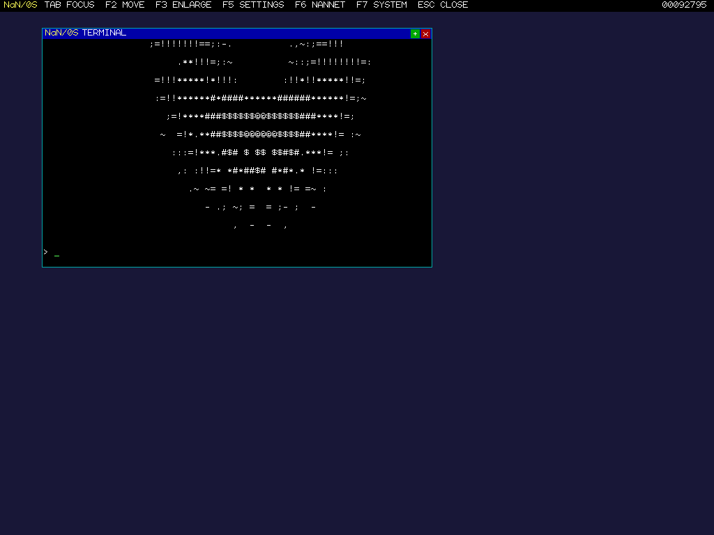

<div align="center">



# NaN/0S

**A computing museum, an experimental operating environment, and a research platform built on double-ended NaN machine words.**

*A different way to represent instructions. A machine that can inspect and rebuild itself.*

[**Try the browser demo**](https://shemshallah.github.io/nan0s/) · [**Get started**](#quick-start) · [**Explore the architecture**](#how-nan16-works) · [**Development status**](#project-status) · [**Support development**](#support-development)

[](https://github.com/shemshallah/nan0s/actions/workflows/android.yml)
[](https://github.com/shemshallah/nan0s/actions/workflows/nan16-coq.yml)
[](LICENSE)

**Independently developed from an Android cellphone. Open source. Experimental by design.**

</div>

> **Project at a glance:** NaN/0S implements its own 64-bit, double-ended NaN16 instruction representation, an x86 boot environment, a guest-written desktop and computing-history exhibits, in-guest assembly and interpretation, a portable C runtime used by Android, and a growing collection of language, networking, storage, and formal-verification experiments. It is **not** a production-ready general-purpose operating system, a complete ISO C implementation, or a secure platform for sensitive workloads.

## Why NaN/0S exists

Most computing platforms treat an IEEE 754 NaN as an exceptional floating-point value. NaN/0S asks a different question: **what if the unusual structure at both ends of a word were the foundation of a machine?**

NaN16 uses 64-bit words containing two deliberately constrained, NaN-like 16-bit headers around a 32-bit payload. Each header has four legal classes. Together they encode a four-bit value that can serve as a Boolean truth table and a predication mask. Word reversal exchanges the two faces and has defined mathematical consequences.

Around this idea, NaN/0S is building a self-examining software stack: instruction set, native kernels, assembler, interpreter, filesystem, GUI, language tooling, diagnostic gates, and historical exhibits. The computing museum is not separate from the architecture; **its exhibits actually execute on it**.

This is both a practical engineering project and an investigation into representation, reversibility, bootstrapping, and trust. The intent is to make unusual ideas *executable and testable*, not merely philosophical.

<div align="center">

[](https://shemshallah.github.io/nan0s/)

*Desktop preview — select the image to open the browser-based v86 demonstration.*

</div>

## Project status

**Research prototype · active development · status reviewed November 2026.** “Implemented” means the relevant code and tests exist in this repository; it does not imply wide hardware testing, security review, or production readiness.

| Area | Current state | Evidence / detail |
| --- | --- | --- |
| **NaN16 word format and execution** | Implemented | [ISA specification](spec/NAN16_SPEC.md), [VM specification](spec/NANVM_SPEC.md), [portable core](aarch64/android/core/) |
| **x86 boot and computing museum** | Bootable in QEMU; browser integration provided | [Build scripts](tools/mkall.sh), [boot gate](tools/qgate.sh), [live player source](docs/index.html) |
| **NaN16 desktop and exhibits** | Implemented; evolving | [Guest sources](src/), [screenshots](screencaps/) |
| **Self-hosted assembly / interpretation** | Demonstrated with fixed-point and differential gates | [Self-hosting design](spec/SELF_HOSTING.md), [fixpoint gate](tools/ngate_nfix.sh), [interpreter gate](tools/ngate_n16i.sh) |
| **C on NaN16 (`ncc`)** | Substantial language and library coverage; not a general conformance certification | [Feature-by-feature parity and limits](spec/NCC_PARITY.md), [C11 gate](tools/ncc_iso_c.sh) |
| **TinyCC → NaN16** | Host-built target generates and runs small NaN16 programs; self-hosted TCC remains unfinished | [TCC status and blockers](spec/TCC_NAN16.md) |
| **Python on NaN16** | Small `Py-M1` subset demonstrated, not CPython | [Implemented grammar and exclusions](spec/PYTHON_PORT.md) |
| **Android** | Portable C VM, JNI/Kotlin application, CI build/test workflows; device compatibility still needs validation | [Android project](aarch64/android/), [workflow](.github/workflows/android.yml), [handoff notes](aarch64/android/docs/HANDOFF.md) |
| **Networking** | Guest control plane and bounded protocol tests; complete general-purpose networking is not yet available | [NANNET](src/nannet/README.md), [networking plan](NANNETWORKING.md) |
| **Storage and cryptography** | Filesystem and experimental storage/crypto components | [Storage notes](crypt/STORAGE.md), [security limitations](crypt/README.md) |
| **Formal mathematics** | Coq-certified abstract mirror/address/memory results; implementation refinement remains open | [Proof ledger](formal/nan16/PROOF_STATUS.md) |
| **AArch64 / RISC-V native boot** | Development and smoke-test work; not equivalent to the x86 boot target | [Architecture adapter plan](spec/ARCH_ADAPTERS.md) |

**Important boundaries:** Passing a specific gate verifies that test's stated invariant, not arbitrary software compatibility. The Coq work does not establish a verified operating system. The cryptographic constructions are experimental and should not protect real secrets. A packaged APK is not proof of a successful deployment or installed device test.

## See it run

### Browser demonstration

**[Launch NaN/0S in your browser](https://shemshallah.github.io/nan0s/)**

The demonstration boots the **full built NaN/0S x86 guest image**, not a JavaScript re-creation or a floppy-only reduced mode. The browser [v86](https://github.com/copy/v86) emulator attaches the same complete `nan0s.img` as **two independent virtual devices**: the boot floppy and the primary IDE master. This matches the native [full GUI boot gate](tools/qgate_gui.sh), whose NaN16 ATA loader reads the IDE copy. The guest requires no conventional guest operating system, although the browser and WebAssembly emulator run on a conventional host. The published image is checked against the current build by [the browser-demo verification workflow](.github/workflows/pages.yml).

The museum provides exhibitions on the Manchester Baby, George Boole, the Sierpinski triangle, trusting trust, the Patriot missile failure, double-ended computation, and the project itself. A terminal, monitor, memory tools, and a graphics environment are part of the guest experience. The exact menus and controls may change as the image evolves; the browser player includes touch-friendly controls.

### Screenshots and demonstrations

| Desktop and GUI | C running on NaN16 |
| :---: | :---: |
|  |  |
| [More screenshots](screencaps/) | [C parity report](spec/NCC_PARITY.md) |

## Quick start

These commands are intended for a Linux development environment. The repository's host-side build tools include POSIX shell, GNU awk, and standard binary utilities; running the x86 system also requires QEMU. The Android path is described separately below.

### 1. Clone and build the system image

```sh
git clone https://github.com/shemshallah/nan0s.git
cd nan0s

# Rebuild the base inputs, guest programs and unified boot image.
sh tools/build.sh
```

The primary generated image is `build/nan0s.img`. The host build script also refreshes bundled images and the NaNFS asset. It requires a writable checkout. For a smaller image-only rebuild after guest sources have already been assembled, use `sh tools/mkall.sh`.

### 2. Boot the full x86 environment

The fuller GUI path uses the floppy for the initial boot and a **separate copy** of the image on IDE so the guest loader can read the complete image:

```sh
cp build/nan0s.img /tmp/nan0s-ide.img

qemu-system-i386 -m 512 -boot order=a \
  -drive format=raw,if=floppy,file=build/nan0s.img \
  -drive format=raw,if=ide,file=/tmp/nan0s-ide.img
```

The IDE copy prevents emulator disk writes from modifying the generated source image. For a minimal headless boot check, run:

```sh
sh tools/qgate.sh
```

The graphics regression gate is `sh tools/qgate_gui.sh`; it additionally uses `ffprobe` to inspect the captured framebuffer. See [x86 details](x86/README.md).

### 3. Run the portable C execution core

The C core is useful for development, scripted runs, differential checking, and environments without an x86 emulator:

```sh
make -C aarch64/android nan_cli

./aarch64/android/nan_cli \
  --img build/nan0s.img \
  --steps 6000000 \
  --keys "ESC,ESC,ESC,ESC,ESC,1" \
  --dump-text
```

This runner is **not an interactive full-screen terminal emulator**. It supports scripted keys, step limits, serial output, images, disk attachment, and text/graphics dumps; inspect [`nan_cli.c`](aarch64/android/tools/nan_cli.c) for currently implemented flags.

### 4. Run meaningful tests

For rapid iteration, run **the same v86/WebAssembly core as the browser locally**.
It boots the actual full NaN/0S guest, sends PS/2 keys (including `n`),
executes the raw-NaN16 `build nan0s` replica command, verifies every byte of
the new bootable disk, and then boots that disk in a second WASM machine.

```sh
# One-time setup (Node 22+; Node 24 recommended)
npm install --no-save --no-package-lock v86@0.5.473

# Each iteration — no push or GitHub Actions required
sh tools/build.sh
node tools/wasm_fastcheck.mjs --boot-only  # faster key/boot smoke test
node tools/wasm_fastcheck.mjs              # full bootable replica gate
```

The first run caches SeaBIOS locally; subsequent runs work offline with the
already installed v86 package and cached firmware. This is a **guest image
replication** gate, not proof of reconstructing the entire OS from source. See
[WASM rapid-test instructions](docs/WASM_FAST_LOOP.md) for requirements,
diagnostics, limits, and the self-bootstrap distinction.

```sh
# Native C execution and sanitizer checks
make -C aarch64/android test
make -C aarch64/android asan

# Instruction interpreter / assembler self-consistency
sh tools/ngate_n16i.sh
sh tools/ngate_nfix.sh

# C11 language/library subset and boot checks
sh tools/ncc_iso_c.sh
sh tools/qgate.sh

# Separate, more demanding optional compiler port test
sh tools/tcc_nan16_smoke.sh
```

Some gates require QEMU, compilers, additional development utilities, or substantial execution time. CI runs a much wider suite; see [GitHub Actions](.github/workflows/android.yml). A command's exit status and output are the authority for that local run, not the existence of a script in the tree.

## Developing from an Android phone

NaN/0S is being developed primarily **from a cellphone**. This is part of the project's motivation: serious low-level work should not be limited to someone with a workstation, a large lab, or institutional backing.

There are two useful phone workflows:

**Termux — build and test the portable VM locally.**

```sh
pkg update
pkg install git clang make

git clone https://github.com/shemshallah/nan0s.git
cd nan0s
make -C aarch64/android nan_cli

./aarch64/android/nan_cli \
  --img aarch64/android/app/src/main/assets/nan0s.img \
  --steps 6000000 --keys "ESC,ESC,ESC,ESC,ESC,1" --dump-text
```

This uses the **checked-in image** and therefore does not require the complete x86 image-building toolchain. It is a scripted test, not an interactive touch desktop.

**Android application — build through GitHub Actions.** The [`android` workflow](https://github.com/shemshallah/nan0s/actions/workflows/android.yml) includes an `apk` job that packages a debug APK as the `nan0s-debug-apk` artifact **when the job succeeds**. The [Kotlin/JNI app source](aarch64/android/app/) includes the display/input shell and image assets. Debug artifacts are for testing and may require device-specific fixes; they are not releases from an app store. See [Android handoff](aarch64/android/docs/HANDOFF.md) and [guest protocol boundary](aarch64/android/docs/N16T_GUEST_ABI.md).

Heavy x86/emulation and formal tests can be delegated to CI while code reviews, commits, and local C-core checks are performed on a phone. This is a practical development approach, not a guarantee that every build target runs natively on Android.

## How NaN16 works

**NaN16 is the name of the guest instruction set, not a claim that instructions are 16 bits wide.** An instruction occupies one **64-bit word**:

```text
  byte offsets       0      1       2   3   4   5       6      7
                  +------------+-------------------+------------+
  storage         |  FAR head  | 32-bit payload    | NEAR head  |
                  +------------+-------------------+------------+
  interpretation  | big-endian | little-endian     | little-endian
  example          FF     F8     2A  00  00  00      F8     7F
```

Each 16-bit header must be one of four legal NaN-like encodings:

| Header | Class | Meaning |
| --- | ---: | --- |
| `7FF1` | 0 | Positive signaling |
| `FFF1` | 1 | Negative signaling |
| `7FF8` | 2 | Positive quiet |
| `FFF8` | 3 | Negative quiet |

The two classes combine as **`n = (near_class << 2) | far_class`**, a value from 0 to 15. Depending on the opcode, the class nibble provides the truth table of a two-input Boolean function or a conditional execution mask based on the processor's `Z` and `L` flags.

The Boolean definition is `bit(2a + b, n) = f(a,b)`. Thus the class nibble represents **all 16 Boolean functions of two inputs**. For the `BOOL` instruction, evaluating 32 parallel lanes against the fixed alternating inputs produces `n × 0x11111111`.

Reversing the eight bytes exchanges the two header faces. For the class nibble, this is a two-bit rotation:

```text
rot2(n) = ((n & 3) << 2) | (n >> 2)
```

This gives a precise relationship between the forward and reversed Boolean interpretations. The mirror relationship is part of the architecture rather than an accidental byte-order conversion. Illegal headers cause a **gate trap**; undefined operations trap rather than silently selecting substitute semantics.

The payload encodes the operation and operands. The register model includes 16 32-bit registers (`r0` fixed at zero, `r13` fixed at one, `r14` as stack pointer, `r15` as link). A practical instruction example is:

```text
FFF8_01D00001_F8FF    ; MOVI r13, 1
```

The full instruction definitions, address semantics, float rules, and historical compatibility limits are documented in [`spec/NAN16_SPEC.md`](spec/NAN16_SPEC.md), [`spec/NANVM_SPEC.md`](spec/NANVM_SPEC.md), and [the portable-core operator reference](aarch64/android/core/OPS.md).

### One guest, multiple execution paths

```text
               NaN16 source (.nas)
                       |
                  assembler
                       |
              NaN16 words / image
                       |
         +-------------+--------------+
         |                            |
    Native x86 core              Portable C VM
   BIOS / QEMU / v86            Linux / Termux / JNI
         |                            |
   Museum + desktop           Android app + test CLI

  AArch64 / RISC-V native adapters: separate work in progress
```

The goal is stable **guest instruction semantics** across hosts. It does **not** mean that the x86 kernel, portable C runtime, AArch64 scaffolding, and RISC-V scaffolding are all equally mature or equally bare metal.

## What runs inside the system

### A computing museum made of executable code

The guest includes programs devoted to the Manchester Baby, Boolean logic, Sierpinski/Rule 90, Ken Thompson's “Trusting Trust” question, the Patriot missile arithmetic failure, and NaN/0S's own dual-ended concepts. A curator console lets visitors inspect memory. The exhibits, desktop, window manager, and supporting libraries are built from NaN16 sources rather than recreated as a web-page animation.

The museum uses distinctions such as **re-creation**, **inspired**, and **exact** to distinguish historical interpretation from original artifacts. See the [museum design](spec/MUSEUM_PLAN.md), [trust paper](spec/TRUST_PAPER.md), and [source exhibits](src/exhibits/).

### A self-hosting toolchain and reproducibility gates

The `nasm0` assembler and `n16i` interpreter are themselves NaN16 programs. A fixed-point gate checks whether assembling the assembler reproduces its machine words, including class information; the differential gate compares native execution with execution through the interpreter.

These are valuable **reproducibility and semantic-consistency tests**. They do not eliminate the trusted native boot path, prove a compiler free of malicious behavior, or certify every possible guest program. For the precise threat model and verification limitations, see [self-hosting](spec/SELF_HOSTING.md) and [the Trust paper](spec/TRUST_PAPER.md).

### C, TinyCC, and the language compatibility effort

The guest-native `ncc` effort implements a C front end, execution machinery, and an extensive library subset in NaN16. Its feature gates include pointers, aggregates, control flow, preprocessing, floating-point behavior, file APIs, and many C11 constructs. The precise supported and excluded behaviors — particularly atomics, threading, floating-point environment, alignment, and variable-length arrays — are cataloged in [`NCC_PARITY.md`](spec/NCC_PARITY.md). **“ISO C parity” here describes targeted regression work, not a blanket claim of standard conformance.**

The separate [TinyCC port](spec/TCC_NAN16.md) retargets a host-built TinyCC to emit runnable NaN16 programs. Its present achievement is the **tcc0** target and regression coverage; the next crucial milestone is running TinyCC on NaN16 to build itself (**tcc1 → tcc2**). The current self-hosting harness is not yet at that fixed point.

There is also a [small Python-language experiment](spec/PYTHON_PORT.md) running a restricted grammar through in-guest C execution. It should not be confused with CPython or the full Python standard library.

These pieces are being pursued toward the long-term ability to run larger existing software stacks. **SQLite, full C/C++ compatibility, and hosting mainstream language models are goals, not currently delivered capabilities.**

### Networking, storage, and learning experiments

[NANNET](src/nannet/README.md) implements a guest-side link/address/route/DNS configuration model and testable network operations. Transport adapters and protocol/session code also exist, including Android-facing interfaces. A validated isolated networking test is not the same as a complete live web browser, wireless driver, authenticated remote service, or deployed networked learning system.

The storage work includes NaNFS and experimental file/volume tools. [Cryptography documentation](crypt/README.md) explicitly records which primitives are reference implementations, what remains unimplemented, and where security guarantees **must not** be assumed.

Native head storage and bounded learning counters are documented in [head runtime](docs/N16_HEAD_RUNTIME.md) and [worker image](docs/N16_HEAD_WORKER_IMAGE.md). These are specific guest primitives, **not** evidence that a full language model is already resident or trained in NaN/0S.

## NANDBG

The repository ships NANDBG, a NaN-native debugger, as both a standalone
component and a resident shell ABI. The standalone monitor, typed-record core,
tests, and exact gates live in `src/dbg/` and `src/tests/ndbg_*`; the design is
in `spec/NANDBG.md`, and the integration notes are in
[`docs/NDBG_INTEGRATION.md`](docs/NDBG_INTEGRATION.md).

```sh
sh tools/ndbg.sh       # typed words, mirror, step core
sh tools/ndbg_diff.sh  # native vs stepped, guard/watch, real cart
sh tools/ndbg_mon.sh   # serial monitor
sh tools/ndbg_img.sh   # bare-metal QEMU monitor boot
```

The Silver Slate terminal now has a wired `debug` monitor with `carts`,
`load <id>`, `step`, `run`, `regs`, `break`, `watch`, `bpts`, `wpts`, `mem`,
`reset`, `pc`, and `quit`; `tools/ndbg_term.sh` gates it. The richer
pane CLI is maintained in `shemshallah/ndbg` and will be attached to the same
resident ABI. `tools/ndbg_sync.sh` refreshes the vendored component from an ndbg
checkout.

## Mathematical and formal verification work

The [NaN16 formalization](formal/nan16/) uses Coq to prove properties of mirror operations, canonical addresses, signed orientations, and abstract memory updates. The [R5 proof-status ledger](formal/nan16/PROOF_STATUS.md) identifies the precise kernel-checked theorems and recorded CI results.

Its model includes a 65,536-cell physical address space under the relevant mirror abstraction, with **256 fixed points**, **32,640 two-address mirror pairs**, and **32,896 canonical representatives**. These are *properties of the documented mathematical object*, not a claim that all production guest memory is limited to 64 KiB or that the operating system itself has been formally verified.

The next proof obligations are substantial: connect the bit-list formalization to concrete arithmetic, show that implementation operations refine the abstract model, and handle physical atomicity and concurrency assumptions. Proof scope matters as much as proof success.

## Architecture and repository map

| Path | Purpose |
| --- | --- |
| [`src/`](src/) | NaN16 sources: boot/guest logic, libraries, museum, exhibits, tests, network modules |
| [`src/lib/`](src/lib/) | Guest libraries and `ncc` C pathway |
| [`src/nannet/`](src/nannet/) | Network control, protocols, routing, head/storage experiments |
| [`x86/`](x86/) | x86-specific native and boot material, builders and QEMU tools |
| [`aarch64/android/`](aarch64/android/) | Portable C core, CLI, JNI, Kotlin Android app, tests |
| [`aarch64/native/`](aarch64/native/) and [`riscv/`](riscv/) | Native architecture experiments / smoke work |
| [`tools/`](tools/) | Host-side build scripts, assemblers, differential tests, gates |
| [`formal/nan16/`](formal/nan16/) | Coq development and finite regression checks |
| [`crypt/`](crypt/) | Experimental authenticated file / volume code and test fixtures |
| [`third_party/`](third_party/) | Vendored dependencies, including TinyCC, with their own licenses |
| [`spec/`](spec/) | Specifications, design decisions, parity records, research plans |
| [`docs/`](docs/) | Public browser player and project documentation |
| [`screencaps/`](screencaps/) and [`logs/`](logs/) | Screenshots and recorded test evidence |

**Documentation reading order:** [ISA](spec/NAN16_SPEC.md) → [self-hosting](spec/SELF_HOSTING.md) → [C parity](spec/NCC_PARITY.md) → [TinyCC port](spec/TCC_NAN16.md) → [formal proof status](formal/nan16/PROOF_STATUS.md) → [current task ledger](TODO.md). Some longer design and status documents contain historical snapshots; source code and current tests take precedence when statements conflict.

## Roadmap: the next engineering barriers

These priorities describe research directions, not promised delivery dates:

1. **Complete the compiler bootstrap.** Repair the TinyCC self-hosted call/frame/linkage path; achieve tcc1, then a checked tcc2 fixed point, with reproducible tests and preserved failure cases.
2. **Harden the language/runtime boundary.** Continue C conformance and ABI work, broaden practical libc/system interfaces, and use real programs rather than synthetic successes as compatibility gates.
3. **Move larger applications into the guest.** Extend filesystems, memory management, I/O and library support toward SQLite and other meaningful software packages before claiming general-purpose compatibility.
4. **Improve host and hardware parity.** Keep x86 as a reference while evaluating the Android C path and progressing native AArch64/RISC-V adapters with controlled differential tests.
5. **Complete the networking and security story.** Move from protocol fixtures to authenticated end-to-end integrations; do not advance cryptographic claims without appropriate test vectors and external review.
6. **Connect proofs to execution.** Refine formal mirror/address/memory semantics against the executable implementation, with explicit assumptions and counterexample tests.
7. **Explore advanced workloads.** C++ and language-model hosting remain ambitious downstream goals, contingent on the compiler, runtime, memory, and I/O foundations above.

For the living, much more detailed engineering backlog, see [`TODO.md`](TODO.md). Historic work and rejected paths are retained in the specifications and logs to preserve research provenance.

## Contributing

NaN/0S is **independently led and architecture-driven**. Thoughtful outside contributions are welcome when they reinforce the core design rather than replacing it with a conventional emulator or unrelated operating-system stack.

The most useful contributions are **reproducible bugs, small correctness fixes, independent tests, better documentation, architecture adapters, toolchain parity work, and carefully scoped museum exhibits**. If proposing a larger change, first [open an issue](https://github.com/shemshallah/nan0s/issues) explaining the problem, existing behavior, proposed invariant, and how success will be measured.

A good pull request should include the exact commands used, the observed versus expected result, relevant logs, any additional resource requirements, and a regression test where feasible. Prefer small, reviewable changes; preserve the 64-bit word format and both-face semantics; never silently weaken traps or conformance claims. Keep generated images and large binaries out of unrelated changes.

If you cannot contribute code, a bug report that is easy to reproduce, a careful technical review, or sharing the project with people interested in compilers, operating systems, formal methods, or unconventional architectures is genuinely useful.

## Support development

### Help keep independent systems research moving

**NaN/0S is being built from a cellphone.** Its scope would ordinarily suggest dedicated development machines, hardware test benches, and substantial tooling resources. Instead, this is an independent effort built incrementally through source code, reproducible experiments, and shared CI.

If this project interests you and you have the means, **financial support is welcome and appreciated**. Contributions would help make room for things such as:

- hardware and device testing across architectures;
- build/test infrastructure, storage, and compute needed for repeatable experiments;
- time to investigate difficult compiler, runtime, and verification defects;
- maintaining accessible documentation and public development artifacts.

**Donation arrangements:** This repository does **not currently publish a verified direct-payment or GitHub Sponsors checkout link**. To discuss sponsoring the work or make a financial contribution, contact the maintainer at **[shemshallah@gmail.com](mailto:shemshallah@gmail.com)** (the contact listed in the project's existing documentation) and request an official payment method. A public funding link can be added here and to GitHub's sponsor button once the maintainer has confirmed it. Do not treat unaffiliated payment links as official.

Support is entirely voluntary. **The code stays available under its license regardless of donations.** A contribution does not purchase roadmap control, priority support, private access, a guaranteed milestone, or tax-deductible status. If financial support is not possible, starring the repository, reporting issues, testing, or recommending it to other researchers helps too.

**Thank you for helping make independent, phone-built systems research visible and sustainable.**

## License, credits, and responsibility

The original project code is published under the repository's [Apache License 2.0](LICENSE). **Vendored third-party components retain their own licenses**; check [`third_party/`](third_party/) and the individual notices. The browser demo uses [v86](https://github.com/copy/v86).

NaN/0S is an experimental educational/research system. No warranty, security assurance, compatibility guarantee, or fitness for production use is implied. In particular, avoid relying on its experimental cryptographic components for sensitive data or deploying unreviewed networking code as a secure service.

Developed and maintained by [shemshallah](https://github.com/shemshallah).

---

<div align="center">


**NaN/0S — make the strange parts of computation executable.**

*Two faces. One word. A different machine.*

[Explore the source](https://github.com/shemshallah/nan0s) · [Try the demo](https://shemshallah.github.io/nan0s/) · [Support the project](#support-development)

</div>
